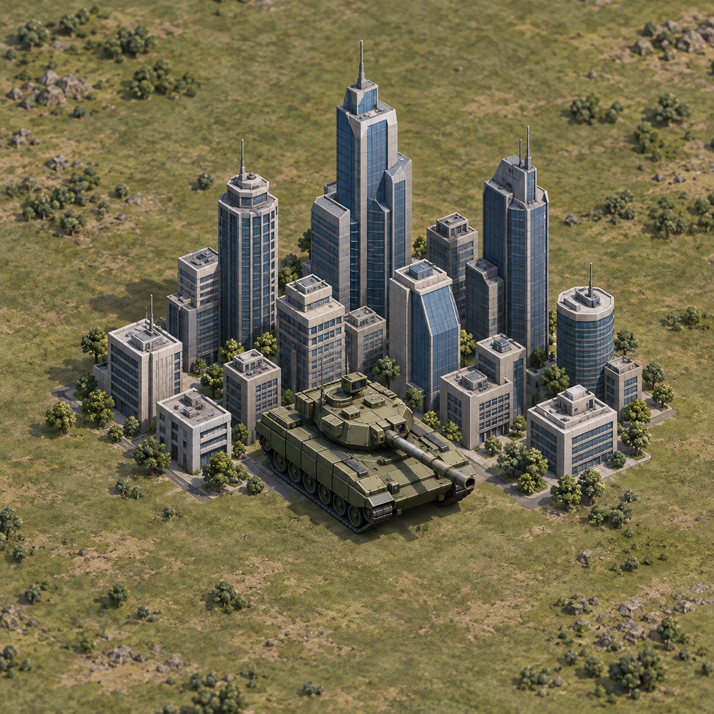
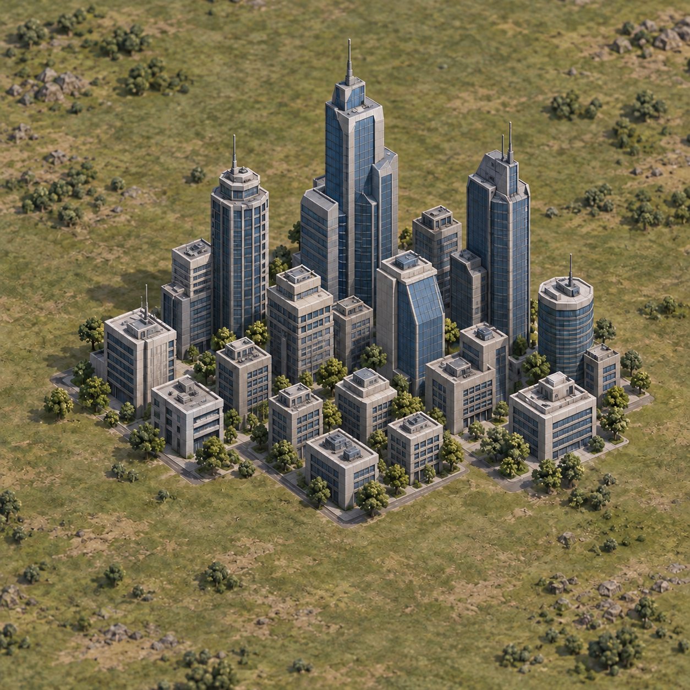

# City skyline concept - owner approval required

15 October 2026. Branch `chatgpt/city-concepts-20261015`, base `6e32091`.
These are AI-generated design concepts, not screenshots or delivered 3D models.
No runtime file has changed. Do not merge into gameplay or start modelling until Matthew approves.

## Occupied city

Compact grey concrete and blue-grey glass skyline, distinct tall skyscrapers and readable
lower buildings. A deliberately enlarged tank overlays the city's front/centre. The unit
must be as readable as the same unit elsewhere on the map; it must not shrink in a city.
No isolated side pad, outlined square, or permanent courtyard hole.

## City after the army leaves

Same skyline, with the tank removed and the lower city restored in its space. The city
returns to a full, continuous cluster. The concept shows the intended appearance, not a
guarantee that the current renderer supports the transition without integration work.

## What the approval covers

Approve or revise the grey/glass style, skyline silhouette, unit readability and occupied /
empty appearance. Exact roof details and tree counts are not gameplay requirements. After
approval, author actual lightweight 3D models and preview them using the real map camera;
do not present an AI render as the completed in-game result.

Proposed production requirements to verify with the approved model:

- Shared unit scale matches open-terrain units; no city-specific shrinking.
- City selection and army selection both remain usable.
- At a distance, skylines remain recognizable and do not merge with nearby cities.
- Occupied and empty states preserve the same outer skyline.
- Use shared materials/instancing, simplified collision/picking and distance-appropriate
  geometry suitable for hundreds of cities. Profile representative phone hardware.
- Claude integrates the approved models with `city_system.gd`, `unit_system.gd`, `main.gd`,
  `strategic_map.gd` and `web_extras.gd`; these reserved files are untouched here.

## Generation record

Built-in ImageGen was used. Occupied concept prompt: one compact low-poly grey/blue-glass
skyscraper cluster on olive-grey map terrain, elevated three-quarter camera, readable oversized
tank layered over the front/centre, complete skyline, no square plinth or cut-out hole, no UI.

The empty-state edit preserves the first image's architecture, camera, light and terrain,
removes the tank and restores several complementary low buildings. Both are separate images.
